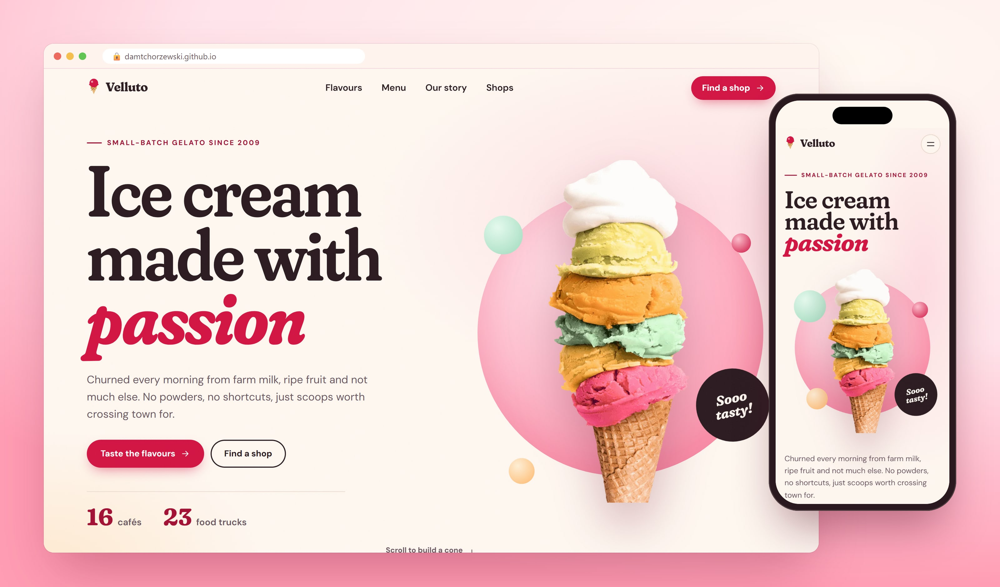
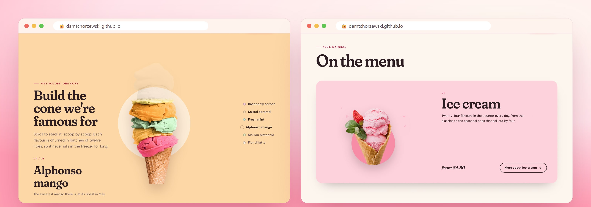
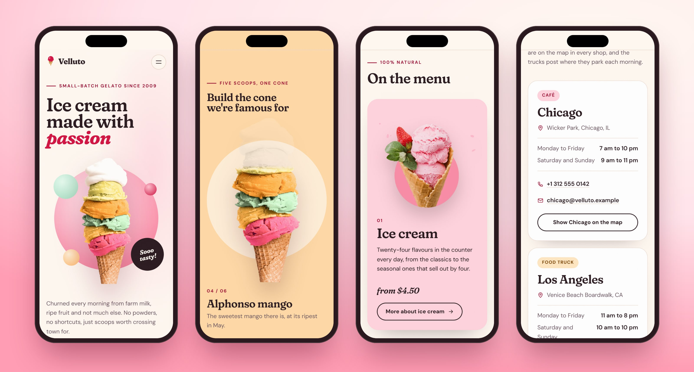

<p align="center">
  <picture>
    <source media="(prefers-color-scheme: dark)" srcset="docs/images/banner-dark.png">
    
  </picture>
</p>

<p align="center">
  
</p>

## About

<a href="https://damtchorzewski.github.io/gelato-brand-website/"></a>

**Velluto** is a one-page, scroll-driven website of a gelato brand. While the visitor scrolls, a waffle cone is built
scoop by scoop, the menu cards stack on top of each other and the brand story unfolds, on a phone as much as on a wide
screen.

- **The cone scene.** A pinned stage where six flavours land on the cone one after another; the background takes each
  flavour's colour and the name and note change with it (`src/components/Flavours.astro`, `src/scripts/motion.ts`).
- **Stacking menu.** Ice cream, ice coffee and milkshakes as large cards that slide over each other (CSS `sticky`);
  "More about" opens a native `<dialog>` with the details.
- **Story, numbers, gallery, reviews, shops.** A step-by-step "How it's made" with a filling rail, counters on a dark
  band with ingredients drifting with the scroll, ten photos in a parallax grid, three reviews (a swipeable row on a
  phone) and three shops with hours, phone, e-mail and a Google map that loads only when asked for.
- **Motion with manners.** GSAP ScrollTrigger and Lenis load after the first paint and only when
  `prefers-reduced-motion` is `no-preference`; with `reduce` (or without JavaScript) the same content is a plain,
  complete layout.
- **WCAG 2.2 AA.** Landmarks, a skip link, one `h1`, a 3 px focus ring, native dialogs that hold and return the focus,
  44 px targets, contrast of every text pair at least 4.5:1 ([docs/frontend.md](docs/frontend.md)); axe runs in the
  end-to-end tests.
- **Fast.** Static HTML from Astro, images turned into WebP in several widths, self-hosted variable fonts.

> **Status:** the brand, the shops, the prices and the reviews are sample content. The photos come from the earlier
> `food-brand-landing-page` project; a Blender cone sequence and product renders are planned
> ([docs/frontend.md](docs/frontend.md#graphics-still-to-make)).

## Tech stack

|         |                                                                                                           |
| ------- | --------------------------------------------------------------------------------------------------------- |
| Stack   | [Astro 7](https://astro.build/), TypeScript, [Tailwind CSS 4](https://tailwindcss.com/)                   |
| UI      | GSAP 3 with ScrollTrigger, Lenis (smooth scrolling), Fraunces and DM Sans (self-hosted, `@fontsource`)    |
| Tests   | Vitest (content and scroll logic), Playwright with axe-core (smoke, WCAG 2.2 AA, reduced motion, dialogs) |
| Hosting | GitHub Pages, published by GitHub Actions (Settings → Pages → Source: GitHub Actions)                     |

The content, code, commits and branches are in English.

## Screenshots

<p align="center">
  
</p>
<p align="center">
  
</p>

## Quick start

```bash
git clone https://github.com/DamTchorzewski/gelato-brand-website.git
cd gelato-brand-website
pnpm install
pnpm dev       # http://localhost:4321
```

Requirements: Node.js 22 (`.nvmrc`) and pnpm 11 (`packageManager` in `package.json`). The end-to-end tests need
Chromium once: `pnpm exec playwright install chromium`.

## Scripts

| Command             | What it does                                                                         |
| ------------------- | ------------------------------------------------------------------------------------ |
| `pnpm dev`          | development server with hot reload                                                   |
| `pnpm build`        | production build to `dist/` (the workflow passes `SITE_URL`)                         |
| `pnpm preview`      | serves `dist/` locally                                                               |
| `pnpm format`       | Prettier, write                                                                      |
| `pnpm format:check` | Prettier, check                                                                      |
| `pnpm lint`         | ESLint with the jsx-a11y rules on the templates                                      |
| `pnpm typecheck`    | `astro check`                                                                        |
| `pnpm test`         | Vitest: the content file and the scroll-step logic                                   |
| `pnpm test:e2e`     | Playwright on desktop and Pixel 7: smoke, axe (WCAG 2.2 AA), reduced motion, dialogs |
| `pnpm check`        | `format:check`, `lint`, `typecheck`, `test`                                          |
| `pnpm health`       | read-only check of the live site (`SITE_URL=… pnpm health`)                          |

## Configuration

One optional variable, listed in [.env.example](.env.example):

| Variable   | What it is                                                                                                                                                                                        |
| ---------- | ------------------------------------------------------------------------------------------------------------------------------------------------------------------------------------------------- |
| `SITE_URL` | public address of the site; its path becomes the base (`/gelato-brand-website/` on GitHub Pages). The deploy workflow reads it from the Pages settings. Empty = a build for the root of any host. |

## Structure

```
src/content/site.ts     ★ every text of the page: brand, flavours, menu, story, reviews, shops
src/components/         ★ one component per section (Hero, Flavours, Menu, Story, Numbers, Gallery, Reviews, Shops)
src/styles/global.css   design tokens (Tailwind @theme), buttons, dialogs, focus ring
src/scripts/main.ts     header, dialogs, lazy map, current section; loads motion.ts when motion is welcome
src/scripts/motion.ts   Lenis and every GSAP ScrollTrigger scene
src/assets/             photos, turned into WebP by astro:assets at build time
public/                 favicon, Apple touch icon, Open Graph image
tests/                  Vitest (*.test.ts) and Playwright (e2e/*.spec.ts)
scripts/health.mjs      live-site check run after a deploy
docs/                   documentation; docs/images/ holds the README images (generated)
.github/workflows/      deploy.yml: check, build, e2e, publish to GitHub Pages from main
```

## Branches and workflows

Shared standards from `reops/standards`: `main` ≤ `develop` ≤ a working branch `<type>/<topic>`, Conventional Commits in
English checked by commitlint in a husky hook, Prettier and ESLint on staged files (`reops/standards/git.md`,
`reops/standards/workflows.md`, level 1).
`deploy.yml` checks and builds every push to `main` and `develop`, runs the end-to-end tests on pull requests and on
`main`, and publishes from `main` only.

**Departures from the standards (and why):**

- **e2e on a level-1 site:** the page is driven by scroll animations and dialogs, so a pull request runs the
  Playwright suite (about two minutes) instead of the build alone.
- **One palette, no theme switch:** the brand is built on its flavour colours; the axe test still runs in the light
  and the dark colour scheme, so a dark mode added later is checked too.

## Documentation

| Document                                 | Covers                                                                 |
| ---------------------------------------- | ---------------------------------------------------------------------- |
| [docs/frontend.md](docs/frontend.md)     | tokens, contrast, motion and accessibility decisions, graphics to make |
| [docs/repository.md](docs/repository.md) | GitHub description, topics and settings                                |

The README images (`docs/images/`) are made by `tools/readme-images`, profile `gelato-brand-website`; working files
go to `.scratch/`. Planned 3D renders will live in `blender-projects/gelato-brand-website`.

---

<p align="center"><a href="https://damreboot.pl"><picture><source media="(prefers-color-scheme: dark)" srcset="docs/images/damreboot/company-dark.svg"></picture></a><a href="https://www.linkedin.com/in/damian-tchorzewski-3b2388275/"><picture><source media="(prefers-color-scheme: dark)" srcset="docs/images/damreboot/linkedin-dark.svg"></picture></a><a href="mailto:damianchabracki@gmail.com"><picture><source media="(prefers-color-scheme: dark)" srcset="docs/images/damreboot/email-dark.svg"></picture></a></p>

<p align="center">
  <picture><source media="(prefers-color-scheme: dark)" srcset="docs/images/damreboot/engineered-dark.svg"></picture> Engineered by <b>Damian Chabracki</b> (DamReboot IT)
</p>
